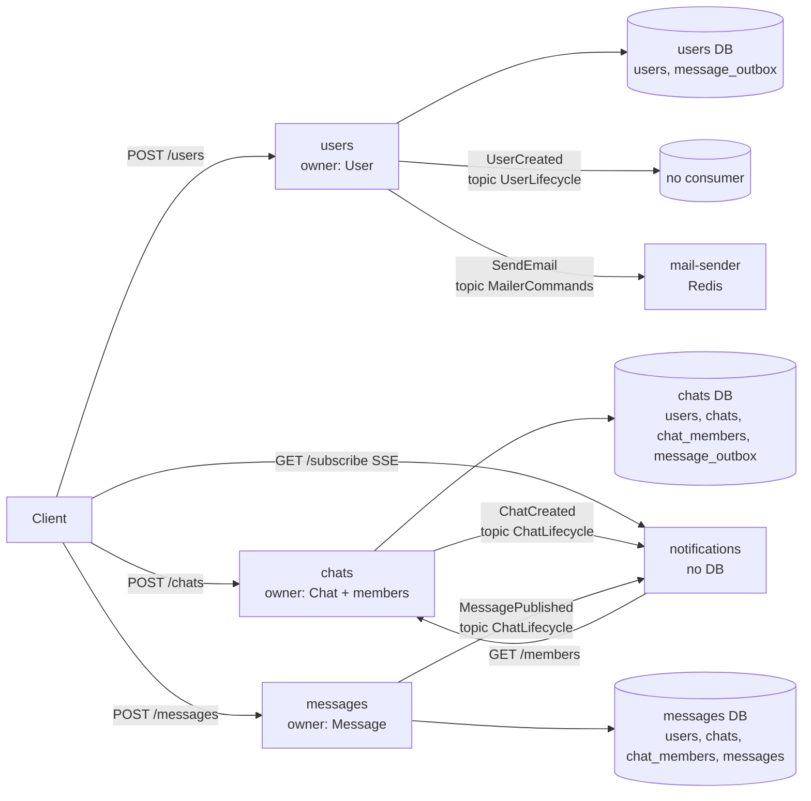
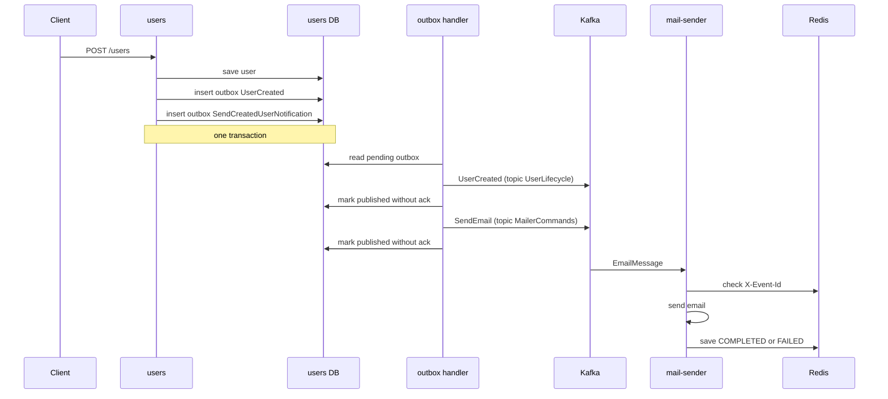
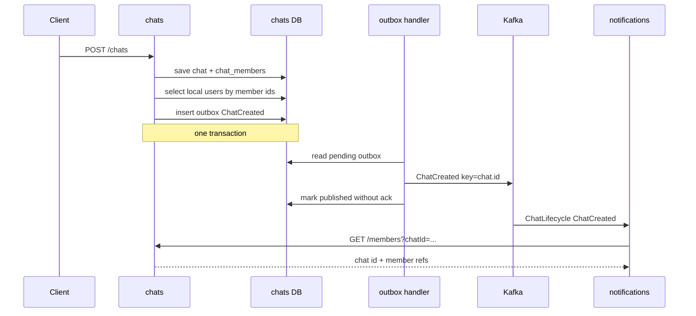
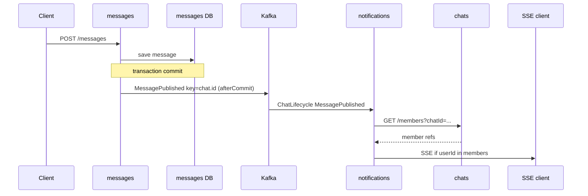

# Передача изменений доменных сущностей между сервисами

**Дата:** 2026-10-26  
**Роль:** system-analyst  
**База анализа:** рабочее дерево, HEAD `f3b62e0`  
**Статус:** анализ текущего состояния. Код, Specs и конфигурация не изменялись.

## 1. Назначение отчёта

Отчёт фиксирует, как основные доменные сущности `shortcut-chat` разделяются между микросервисами:

- какие значения пересекают границы сервисов;
- через какие каналы они передаются;
- какие события и HTTP-вызовы участвуют в потоке;
- где находятся реализации;
- какие пробелы есть в текущем поведении;
- какие задачи-кандидаты нужны для исправления пробелов.

Отчёт не является утверждением нового поведения. Любое изменение контрактов или гарантий требует отдельного OpenSpec change.

## 2. Краткий вывод

1. Общих доменных сущностей между сервисами нет. Каждый сервис держит собственную модель и собственную БД. Compile-зависимости между сервисами запрещены: `openspec/specs/system/architecture/spec.md:9`.
2. Между сервисами передаются снимки значений или ссылки:
   - `User { id, name, email }`;
   - `ChatCreatedEvent { id, name, owner ref, member refs, createdAt }`;
   - `Message { id, text, chat ref, author ref, createdAt }`;
   - `EmailMessage { to, subject, body }`.
3. Основной асинхронный канал — Kafka. Единственный разрешённый синхронный вызов — `notifications` к `chats` через `GET /members`: `openspec/specs/system/architecture/spec.md:36`.
4. Реально передаются только события создания. Изменение пользователя через `PUT /users/{id}` не публикует событие. Обновление чата и сообщения не реализовано.
5. Локальные read-модели `users` и `chats` в сервисах `chats` и `messages` существуют в схеме, но consumer'ов синхронизации нет. Эти таблицы не заполняются main-кодом.
6. `UserCreated` содержит полный `User`, но consumer отсутствует.
7. `ChatCreated` и `MessagePublished` содержат только ссылки на пользователей и чаты. Имён и email участников в них нет.
8. `notifications` получает актуальное членство через HTTP `GET /members`, а не из payload события.

## 3. Метод и границы

Изучены:

- архитектурные Specs: `openspec/specs/system/`;
- правила границ и контрактов: `.agents/rules/architecture/`;
- main-код модулей `users`, `chats`, `messages`, `notifications`, `mail-sender`, `common`;
- Liquibase-миграции;
- `application.yaml` модулей;
- существующие тесты и фикстуры только для проверки фактов о read-моделях.

Не выполнялись:

- сборка;
- тесты;
- миграции;
- изменение кода, Specs или конфигурации.

Важно: в рабочем дереве есть незакоммиченные изменения, не относящиеся к этому отчёту. Они не затрагивались.

## 4. Глоссарий

| Сущность | Владелец | Значение |
|---|---|---|
| `User` | `users` | `id`, `name`, `email` |
| `Chat` | `chats` | `id`, `name`, `owner`, `members`, `createdAt` |
| `ChatMembers` | `chats` | `id` чата и ссылки на участников |
| `Message` | `messages` | `id`, `text`, `chat ref`, `author ref`, `createdAt` |
| `UserRef` | каждый сервис | только `UUID` пользователя |
| `ChatRef` | каждый сервис | только `UUID` чата |
| `EmailMessage` | `users`, `mail-sender` | `to`, `subject`, `body` |
| Outbox record | `users`, `chats` | `type`, `version`, `key`, `body`, `publishedAt` |
| Read model | `chats`, `messages` | локальные копии `users`, `chats`, `chat_members` |

Модели дублируются по сервисам, а не шарятся через общий модуль:

- `User`:
  - `users/src/main/kotlin/io/averkhoglyad/shortcut/users/core/model/User.kt:5`;
  - `chats/src/main/kotlin/io/averkhoglyad/shortcut/chat/core/model/User.kt:5`;
  - `messages/src/main/kotlin/io/averkhoglyad/shortcut/message/core/model/User.kt:5`.
- `Chat`:
  - `chats/src/main/kotlin/io/averkhoglyad/shortcut/chat/core/model/Chat.kt:11`;
  - `messages/src/main/kotlin/io/averkhoglyad/shortcut/message/core/model/Chat.kt:5`.
- `Message`:
  - `messages/src/main/kotlin/io/averkhoglyad/shortcut/message/core/model/Message.kt:11`;
  - `notifications/src/main/kotlin/io/averkhoglyad/shortcut/notification/data/ChatLifecycleEvent.kt:32`.
- `EmailMessage`:
  - `users/src/main/kotlin/io/averkhoglyad/shortcut/users/core/model/EmailMessage.kt:6`;
  - `mail-sender/src/main/kotlin/io/averkhoglyad/shortcut/mail/sender/core/mailer/EmailMessage.kt:6`.

## 5. Владение данными и топология

| Сервис | Хранилище | Владеет | Публикует | Потребляет |
|---|---|---|---|---|
| `users` | PostgreSQL + outbox | `User` | `UserCreated`, `SendEmail` | — |
| `chats` | PostgreSQL + outbox | `Chat`, членство | `ChatCreated` | — |
| `messages` | PostgreSQL | `Message` | `MessagePublished` | — |
| `notifications` | нет | — | — | `ChatCreated`, `MessagePublished` |
| `mail-sender` | Redis | состояние доставки | — | `SendEmail` |

Инвентарь топиков и событий: `openspec/specs/system/kafka-messaging/spec.md:13`.

Требование владения данными: каждый сервис владеет своей схемой и не читает таблицы другого сервиса: `openspec/specs/system/architecture/spec.md:18`.

## 6. Визуализация потоков

### 6.1. Общая схема

### 6.2. Создание пользователя

### 6.3. Создание чата

### 6.4. Публикация сообщения и SSE

## 7. Флоу по доменным сущностям

### 7.1. Создание пользователя

Точка входа: `POST /users`, `users/src/main/kotlin/io/averkhoglyad/shortcut/users/api/controller/UserController.kt:27`.

Шаги:

1. `UserServiceImpl.create` сохраняет `UserEntity` в транзакции: `users/src/main/kotlin/io/averkhoglyad/shortcut/users/core/service/UserService.kt:53`.
2. Создаётся outbox-запись `UserCreated` с телом `User`: `users/src/main/kotlin/io/averkhoglyad/shortcut/users/core/service/message/UserCreatedMessageFactory.kt:10`.
3. Создаётся outbox-запись `SendCreatedUserNotification` с телом `EmailMessage`: `users/src/main/kotlin/io/averkhoglyad/shortcut/users/core/service/message/SendCreatedUserNotificationMessageFactory.kt:11`.
4. Обе записи пишутся в БД в той же транзакции: `users/src/main/kotlin/io/averkhoglyad/shortcut/users/outbox/OutboxService.kt:21`.
5. Scheduler запускает outbox handler каждую секунду: `users/src/main/kotlin/io/averkhoglyad/shortcut/users/config/ScheduleConfig.kt:34`.
6. Outbox handler выбирает топик по типу:
   - `SendCreatedUserNotification` → `MailerCommands`;
   - `UserCreated` → `UserLifecycle`.
   Код: `users/src/main/kotlin/io/averkhoglyad/shortcut/users/outbox/OutboxHandler.kt:67`.
7. Заголовки добавляются в `users/src/main/kotlin/io/averkhoglyad/shortcut/users/outbox/OutboxHandler.kt:79`:
   - `X-Event-Id`;
   - `X-Event-Name`;
   - `X-Event-Version`;
   - `X-Published-At`;
   - `X-Published-By`.
8. Для email-команды `X-Event-Name` заменяется на `SendEmail`: `users/src/main/kotlin/io/averkhoglyad/shortcut/users/outbox/OutboxHandler.kt:74`.
9. `mail-sender` читает `MailerCommands` и передаёт `EmailMessage` в `MailSendService`: `mail-sender/src/main/kotlin/io/averkhoglyad/shortcut/mail/sender/api/SendCommandHandler.kt:14`.
10. Идемпотентность хранится в Redis с ключом `X-Event-Id` и TTL 30 дней: `mail-sender/src/main/kotlin/io/averkhoglyad/shortcut/mail/sender/core/persistence/MessageEntity.kt:8`.
11. При статусе `COMPLETED` повторная отправка не выполняется: `mail-sender/src/main/kotlin/io/averkhoglyad/shortcut/mail/sender/core/service/MailSendService.kt:37`.

Факты и ограничения:

- Имена методов в `UserService` инвертированы: `sendNotification` пишет `UserCreated`, `emitUserCreatedLifecycleEvent` пишет email. Фактический тип определяет фабрика, не имя метода.
- `UserCreated` уходит в `UserLifecycle`, но consumer отсутствует: `openspec/specs/system/kafka-messaging/spec.md:16`.
- `UserServiceImpl.update` не публикует событие. Там только TODO и логи: `users/src/main/kotlin/io/averkhoglyad/shortcut/users/core/service/UserService.kt:94`.
- Outbox handler не ждёт подтверждения Kafka: `users/src/main/kotlin/io/averkhoglyad/shortcut/users/outbox/OutboxHandler.kt:44`, `:63`.
- В outbox `users` нет поля `key`. Схема: `users/src/main/resources/migrations/v1/002__Create-MessageOutbox-table.xml:7`, сущность: `users/src/main/kotlin/io/averkhoglyad/shortcut/users/core/persistence/entity/OutboxMessageEntity.kt:10`.

### 7.2. Создание чата

Точка входа: `POST /chats`, `chats/src/main/kotlin/io/averkhoglyad/shortcut/chat/api/controller/ChatController.kt:43`.

Шаги:

1. `ChatServiceImpl.create` сохраняет чат с участниками в транзакции: `chats/src/main/kotlin/io/averkhoglyad/shortcut/chat/core/service/ChatService.kt:57`.
2. Участники читаются из локальной таблицы `users` сервиса `chats`: `chats/src/main/kotlin/io/averkhoglyad/shortcut/chat/core/service/ChatService.kt:60`.
3. Формируется `ChatCreatedEvent`: `chats/src/main/kotlin/io/averkhoglyad/shortcut/chat/core/service/message/ChatCreatedMessageFactory.kt:13`.
4. В событие попадают:
   - `id`;
   - `name`;
   - `owner` как `UserRef?`;
   - `members` как `Collection<UserRef>`;
   - `createdAt`.
   Модель: `chats/src/main/kotlin/io/averkhoglyad/shortcut/chat/core/model/ChatEvent.kt:6`.
5. Outbox пишется с `propagation = MANDATORY`, то есть в транзакции создания чата: `chats/src/main/kotlin/io/averkhoglyad/shortcut/chat/outbox/OutboxService.kt:22`.
6. Outbox handler отправляет событие в `ChatLifecycle` с ключом `chat.id`: `chats/src/main/kotlin/io/averkhoglyad/shortcut/chat/outbox/OutboxHandler.kt:59`.
7. `notifications` получает событие и позже запрашивает актуальных участников через HTTP: `notifications/src/main/kotlin/io/averkhoglyad/shortcut/notification/service/NotificationService.kt:47`.
8. Ответ `GET /members` формирует `ChatMembers` с `UserRef`: `chats/src/main/kotlin/io/averkhoglyad/shortcut/chat/api/controller/ChatMembersController.kt:18`, `chats/src/main/kotlin/io/averkhoglyad/shortcut/chat/core/service/ChatService.kt:66`.

Факты и ограничения:

- В `ChatCreatedEvent` нет имён и email участников. Только `UserRef`.
- `ChatRequest` не содержит `owner`. Конвертер выставляет только `name` и `members`: `chats/src/main/kotlin/io/averkhoglyad/shortcut/chat/core/converter/ChatConverter.kt:36`. При создании `owner` остаётся `null`, и `ChatCreatedEvent.owner` тоже `null`.
- Локальная таблица `users` сервиса `chats` имеет `external_id NOT NULL UNIQUE`, `last_sync_at`, `is_deleted`: `chats/src/main/resources/migrations/v1/001__Create-User-table.xml:7`.
- `UserRepository` в `chats` используется только на чтение: `chats/src/main/kotlin/io/averkhoglyad/shortcut/chat/core/service/ChatService.kt:51`, `chats/src/main/kotlin/io/averkhoglyad/shortcut/chat/core/service/ChatService.kt:60`.
- Consumer'а `UserCreated` в `chats` нет.
- `chat_members.user_id` имеет FK на локальную `users.id`: `chats/src/main/resources/migrations/v1/003__Create-Member-table.xml:38`. Без предварительно созданных строк `users` создание чата упрётся в FK.
- `UserCreated` не содержит `external_id`. Заполнить обязательное поле `external_id` из текущего события нельзя без дополнительного правила маппинга.

### 7.3. Публикация сообщения

Точка входа: `POST /messages`, `messages/src/main/kotlin/io/averkhoglyad/shortcut/message/api/controller/MessageController.kt:37`.

Шаги:

1. `MessageServiceImpl.create` сохраняет сообщение: `messages/src/main/kotlin/io/averkhoglyad/shortcut/message/core/service/MessageService.kt:50`.
2. Публикация регистрируется через `afterCommit`: `messages/src/main/kotlin/io/averkhoglyad/shortcut/message/core/service/MessageService.kt:58`.
3. `ChatLifecycleEventPublisher` отправляет `ProducerRecord`: `messages/src/main/kotlin/io/averkhoglyad/shortcut/message/core/output/ChatLifecycleEventPublisher.kt:20`.
4. Событие `MessagePublished`:
   - topic `ChatLifecycle`;
   - key = `chat.id`;
   - payload = `Message { id, text, chat ref, author ref, createdAt }`.
   Код: `messages/src/main/kotlin/io/averkhoglyad/shortcut/message/core/output/ChatCreatedMessageFactory.kt:33`.
5. `X-Event-Id` генерируется случайно, не равен `message.id`: `messages/src/main/kotlin/io/averkhoglyad/shortcut/message/core/output/ChatCreatedMessageFactory.kt:37`.
6. Outbox нет. При ошибке отправки после commit событие теряется. Текущее поведение: `openspec/specs/system/runtime-guarantees/spec.md:40`.

Факты и ограничения:

- В `MessagePublished` нет имён пользователя и чата. Только ссылки.
- Локальные read-модели `users`, `chats`, `chat_members` в `messages` есть в схеме:
  - `messages/src/main/resources/migrations/v1/001__Create-User-table.xml:7`;
  - `messages/src/main/resources/migrations/v1/002__Create-Chat-table.xml:7`;
  - `messages/src/main/resources/migrations/v1/003__Create-Member-table.xml:7`.
- В main-коде `messages` репозитории `UserRepository` и `ChatRepository` только объявлены:
  - `messages/src/main/kotlin/io/averkhoglyad/shortcut/message/core/persistence/repository/UserRepository.kt:8`;
  - `messages/src/main/kotlin/io/averkhoglyad/shortcut/message/core/persistence/repository/ChatRepository.kt:8`.
- Вызовов сохранения или чтения этих репозиториев в main-коде нет.
- Consumer'ов `UserCreated` или `ChatCreated` в `messages` нет.
- `messages` требует локальные строки `users` и `chats` из-за FK: `messages/src/main/resources/migrations/v1/004__Create-Message-table.xml:38`.
- Фактическая передача значений пользователя и чата в `messages` не реализована. Передаются только UUID-ссылки в событии сообщения.

### 7.4. Доставка в notifications и SSE

Точка входа: `GET /subscribe?userId=...`, `notifications/src/main/kotlin/io/averkhoglyad/shortcut/notification/config/WebConfig.kt:27`.

Шаги:

1. Consumer читает `ChatLifecycle`, group `notifications-app`: `notifications/src/main/kotlin/io/averkhoglyad/shortcut/notification/api/ChatLifecycleEventsHandler.kt:15`, `notifications/src/main/resources/application.yaml:8`.
2. Тип payload выбирается по `X-Event-Name`:
   - `ChatCreated` → `ChatCreated`;
   - `MessagePublished` → `MessagePublished`;
   - иначе `Map`.
   Код: `notifications/src/main/kotlin/io/averkhoglyad/shortcut/notification/kafka/ChatLifecycleTypeResolver.kt:14`.
3. Событие кладётся в `MutableSharedFlow` без replay: `notifications/src/main/kotlin/io/averkhoglyad/shortcut/notification/service/NotificationService.kt:32`.
4. События собираются окном 1 минута: `notifications/src/main/kotlin/io/averkhoglyad/shortcut/notification/service/NotificationService.kt:33`, `notifications/src/main/resources/application.yaml:25`.
5. Для батча выполняется `GET /members?chatId=...` в `chats`: `notifications/src/main/kotlin/io/averkhoglyad/shortcut/notification/service/NotificationService.kt:47`.
6. HTTP-клиент объявлен через `@HttpExchange`: `notifications/src/main/kotlin/io/averkhoglyad/shortcut/notification/integration/chat.kt:30`.
7. SSE отдаёт только события, где `userId` входит в актуальный список участников: `notifications/src/main/kotlin/io/averkhoglyad/shortcut/notification/api/NotificationSubscriptionHandler.kt:35`.
8. Участники берутся из ответа `chats`, а не из payload события. Поле `members` в `ChatCreatedEvent` для фильтрации не используется.
9. Контракт `GET /members`: `openspec/specs/system/rest-api/spec.md:35`.

Факты и ограничения:

- `notifications` не хранит доменные значения. Только пропускает события и обогащает их ссылками на участников.
- SSE live-only, без replay. Требование к replay не зафиксировано: `openspec/specs/system/runtime-guarantees/spec.md:43`.
- Если `chats` недоступен, обогащение участниками падает. Fallback не реализован.
- Identity для SSE читается из query `userId`: `openspec/specs/system/rest-api/spec.md:100`.

### 7.5. Email как производное значение пользователя

`EmailMessage` не является доменной сущностью. Это снимок значений пользователя в момент регистрации:

- `to = [user.email]`;
- `subject = "Welcome ${user.name}!"`;
- `body` содержит `user.name`.

Код: `users/src/main/kotlin/io/averkhoglyad/shortcut/users/core/service/message/SendCreatedUserNotificationMessageFactory.kt:12`.

Следствие: изменение `User.name` или `User.email` после создания не влияет на уже созданную команду. Новых email-команд при обновлении пользователя нет.

## 8. Что именно передаётся между сервисами

| Данные | Владелец | Что пересекает границу | Канал | Потребитель |
|---|---|---|---|---|
| `User` при создании | `users` | `id`, `name`, `email` | Kafka `UserLifecycle` | нет |
| `User` при обновлении | `users` | ничего | нет | нет |
| `EmailMessage` | `users` | `to`, `subject`, `body` | Kafka `MailerCommands` | `mail-sender` |
| `Chat` при создании | `chats` | `id`, `name`, `owner ref`, `member refs`, `createdAt` | Kafka `ChatLifecycle` | `notifications` |
| Членство в чате | `chats` | `chat id`, `member refs` | HTTP `GET /members` | `notifications` |
| `Message` | `messages` | `id`, `text`, `chat ref`, `author ref`, `createdAt` | Kafka `ChatLifecycle` | `notifications` |
| Профиль пользователя для `chats` | `users` | ничего | нет | нет |
| Профиль пользователя для `messages` | `users` | ничего | нет | нет |
| Данные чата для `messages` | `chats` | ничего | нет | нет |

Практический вывод: значения `User.name`, `User.email`, `Chat.name` живут только в сервисе-владельце и в локальных read-моделях, которые не синхронизируются. Между сервисами ходят идентификаторы и снимки на момент создания.

## 9. Kafka-контракт, сериализация и заголовки

### 9.1. События и топики

| Topic | Producer | Event name | Consumer |
|---|---|---|---|
| `MailerCommands` | `users` | `SendEmail` | `mail-sender` |
| `UserLifecycle` | `users` | `UserCreated` | нет |
| `ChatLifecycle` | `chats` | `ChatCreated` | `notifications` |
| `ChatLifecycle` | `messages` | `MessagePublished` | `notifications` |

Источник: `openspec/specs/system/kafka-messaging/spec.md:13`.

### 9.2. Payload

| Event | Payload |
|---|---|
| `UserCreated` | `User { id, name, email }` |
| `SendEmail` | `EmailMessage { to, subject, body }` |
| `ChatCreated` | `ChatCreatedEvent { id, name, owner, members, createdAt }` |
| `MessagePublished` | `Message { id, text, chat, author, createdAt }` |

Источник: `openspec/specs/system/kafka-messaging/spec.md:44`.

### 9.3. Сериализация

| Сервис | Роль | Настройка |
|---|---|---|
| `users` | producer | `ByteArraySerializer`, JSON собирает `ObjectMapper` в outbox: `users/src/main/resources/application.yaml:24`, `users/src/main/kotlin/io/averkhoglyad/shortcut/users/outbox/OutboxService.kt:27` |
| `chats` | producer | `ByteArraySerializer`, JSON собирает `ObjectMapper` в outbox: `chats/src/main/resources/application.yaml:24`, `chats/src/main/kotlin/io/averkhoglyad/shortcut/chat/outbox/OutboxService.kt:29` |
| `messages` | producer | `JsonSerializer`, `spring.json.use.type.headers=false`: `messages/src/main/resources/application.yaml:24` |
| `mail-sender` | consumer | `JsonDeserializer`, type headers off, default type `EmailMessage`: `mail-sender/src/main/resources/application.yaml:8`, `mail-sender/src/main/kotlin/io/averkhoglyad/shortcut/mail/sender/api/SendCommandHandler.kt:17` |
| `notifications` | consumer | `JsonDeserializer` + `ChatLifecycleTypeResolver` по `X-Event-Name`: `notifications/src/main/kotlin/io/averkhoglyad/shortcut/notification/config/KafkaConfig.kt:35` |

### 9.4. Заголовки

Каждое событие должно нести:

- `X-Event-Id`;
- `X-Event-Name`;
- `X-Event-Version`;
- `X-Published-At`;
- `X-Published-By`.

Константы:

- `users/src/main/kotlin/io/averkhoglyad/shortcut/users/outbox/OutboxHandler.kt:92`;
- `chats/src/main/kotlin/io/averkhoglyad/shortcut/chat/outbox/OutboxHandler.kt:90`;
- `messages/src/main/kotlin/io/averkhoglyad/shortcut/message/core/output/ChatCreatedMessageFactory.kt:46`;
- `notifications/src/main/kotlin/io/averkhoglyad/shortcut/notification/kafka/ChatLifecycleTypeResolver.kt:26`.

Отличия:

- `users` и `chats`: `X-Event-Id` равен id outbox-записи.
- `messages`: `X-Event-Id` случайный `UUID`.
- `users` outbox не задаёт Kafka key.
- `chats` outbox задаёт key = `chat.id`.
- `messages` задаёт key = `chat.id`.

## 10. Локальные read-модели: факт и расхождение

В `chats` и `messages` есть таблицы, выглядящие как реплики чужих сущностей:

- `users`: `id`, `external_id`, `name`, `email`, `last_sync_at`, `is_deleted`;
- `chats`: `id`, `name`, `last_sync_at`, `is_deleted`;
- `chat_members`: `chat_id`, `user_id`, `created_at`.

Схемы:

- `chats/src/main/resources/migrations/v1/001__Create-User-table.xml:7`;
- `chats/src/main/resources/migrations/v1/002__Create-Chat-table.xml:7`;
- `chats/src/main/resources/migrations/v1/003__Create-Member-table.xml:7`;
- `messages/src/main/resources/migrations/v1/001__Create-User-table.xml:7`;
- `messages/src/main/resources/migrations/v1/002__Create-Chat-table.xml:7`;
- `messages/src/main/resources/migrations/v1/003__Create-Member-table.xml:7`.

Сущности:

- `chats/src/main/kotlin/io/averkhoglyad/shortcut/chat/core/persistence/entity/UserEntity.kt:12`;
- `chats/src/main/kotlin/io/averkhoglyad/shortcut/chat/core/persistence/entity/ChatEntity.kt:14`;
- `messages/src/main/kotlin/io/averkhoglyad/shortcut/message/core/persistence/entity/UserEntity.kt:12`;
- `messages/src/main/kotlin/io/averkhoglyad/shortcut/message/core/persistence/entity/ChatEntity.kt:12`.

Расхождения:

- В `chats` consumer'ов нет. `UserLifecycle` не читается.
- В `messages` consumer'ов нет.
- `UserCreated` никто не потребляет: `openspec/specs/system/kafka-messaging/spec.md:16`.
- Синхронизация read-моделей `users` официально не реализована: `openspec/specs/system/runtime-guarantees/spec.md:44`.
- В `messages` репозитории read-моделей не используются в main-коде.
- В `chats` локальные `users` читаются для ответов `ChatDetails`, но не обновляются: `chats/src/main/kotlin/io/averkhoglyad/shortcut/chat/core/converter/ChatConverter.kt:53`.
- `ChatDetails` отдаёт `name` и `email` из локальной таблицы `chats.users`: `chats/src/main/kotlin/io/averkhoglyad/shortcut/chat/core/converter/UserConverter.kt:15`. Это не текущие значения из `users`.

## 11. Допущения

1. `UserCreated` задуман как событие для будущей синхронизации read-моделей. Подтверждения в коде нет.
2. `external_id` в `chats.users` и `messages.users` — внешний бизнес-ключ пользователя. Источник и правило маппинга не определены.
3. `GET /members` — единственный источник актуального членства для `notifications`. Так задумано архитектурной спецификацией: `openspec/specs/system/architecture/spec.md:36`.
4. Ответы `chats` про участников должны отражать актуальные значения пользователей. Требование явно не зафиксировано; текущий код читает локальную копию.
5. `UserCreated` и `ChatCreated` считаются снимками на момент создания, а не потоком изменений.
6. Outbox считается транспортом «хотя бы один раз». Фактическая гарантия не подтверждена: ack Kafka не ожидается.
7. Идентификаторы `User`, `Chat`, `Message` — UUID, стабильные между сервисами.
8. Данные в локальных read-моделях могут быть созданы вне кода сервиса, например вручную или миграцией. В репозитории такого механизма нет.

## 12. Пробелы и риски

| ID | Пробел | Последствие |
|---|---|---|
| G-01 | Нет события изменения пользователя | `PUT /users/{id}` не распространяет `name` и `email` |
| G-02 | Нет consumer'а `UserCreated` | `UserLifecycle` не влияет на `chats` и `messages` |
| G-03 | Нет consumer'ов `ChatCreated`/`UserCreated` в `messages` | Локальные `chats`/`users` в `messages` не наполняются |
| G-04 | Read-модели не заполняются main-кодом | Создание чата и сообщения может упасть на FK при пустых таблицах |
| G-05 | `UserCreated` не содержит `external_id` | Нельзя заполнить обязательное `external_id` без нового правила |
| G-06 | `ChatCreated` не содержит имён и email | Нельзя обогатить пользовательские read-модели из этого события |
| G-07 | `ChatCreated.owner` всегда `null` при создании | Владелец не передаётся в событии и ответе |
| G-08 | `messages` публикует после commit без outbox | Событие может потеряться |
| G-09 | Outbox не ждёт ack Kafka | Запись может быть помечена опубликованной при потере |
| G-10 | `messages` использует случайный `X-Event-Id` | Нельзя дедуплицировать по id сообщения |
| G-11 | Outbox `users` не задаёт Kafka key | Порядок событий по пользователю не гарантирован |
| G-12 | Нет событий обновления/удаления чата, сообщения, членства | Изменения после создания не передаются |
| G-13 | `notifications` не хранит состояние | Пропущенные события не восстанавливаются, SSE live-only |
| G-14 | `notifications` зависит от `chats` в момент доставки | Недоступность `chats` ломает обогащение участниками |
| G-15 | `mail-sender` глотает ошибку отправки | Статус `FAILED`, но retry/DLQ нет |

## 13. Кандидаты в задачи

Статус всех задач: **кандидат**. Не утверждено. Не реализовывать без OpenSpec change и отдельного подтверждения.

### 13.1. Сводная таблица

| ID | Приоритет | Задача | Зависит от | Затрагиваемые Specs |
|---|---|---|---|---|
| CAND-01 | P1 | Контракт синхронизации пользователя | — | `kafka-messaging`, `architecture` |
| CAND-02 | P1 | Синхронизация пользователей в `chats` | CAND-01, CAND-05 | `kafka-messaging`, `runtime-guarantees` |
| CAND-03 | P1 | Синхронизация пользователей в `messages` | CAND-01, CAND-05 | `kafka-messaging`, `runtime-guarantees` |
| CAND-04 | P1 | Синхронизация чатов в `messages` | CAND-01 | `kafka-messaging`, `runtime-guarantees` |
| CAND-05 | P1 | Bootstrap и правило `external_id` | CAND-01 | `architecture`, `runtime-guarantees` |
| CAND-06 | P2 | События изменения чата, сообщения и членства | CAND-01 | `kafka-messaging` |
| CAND-07 | P2 | Усиление outbox и порядка событий | — | `runtime-guarantees`, `kafka-messaging` |
| CAND-08 | P2 | Идемпотентность событий сообщений | CAND-07 | `kafka-messaging`, `runtime-guarantees` |
| CAND-09 | P2 | Восстановление пропущенных уведомлений | CAND-06 | `runtime-guarantees`, `rest-api` |
| CAND-10 | P3 | Fallback `notifications` при недоступности `chats` | CAND-04 | `runtime-guarantees` |
| CAND-11 | P3 | Retry/DLQ для `mail-sender` | CAND-07 | `runtime-guarantees`, `kafka-messaging` |
| CAND-12 | P3 | Владелец чата в контракте создания | CAND-01 | `rest-api`, `kafka-messaging` |

### 13.2. CAND-01. Контракт синхронизации пользователя

**Проблема:** `UserCreated` не покрывает изменение и удаление пользователя. Read-модели требуют `external_id`, которого нет в событии.

**Желаемый результат:** согласованный контракт событий пользователя, пригодный для синхронизации `chats` и `messages`.

**Объём:**

- определить набор событий: создание, изменение, удаление;
- определить поля события, включая `id`, `name`, `email`, `external_id`, признак удаления;
- определить версию события и правила совместимости;
- зафиксировать поведение при повторной доставке.

**Критерии приёмки:**

- контракт описан в Specs через OpenSpec change;
- для каждого события указаны producer, topic, payload, заголовки и consumer'ы;
- `external_id` имеет определённый источник и правило заполнения;
- аддитивность и версионирование соответствуют `.agents/rules/architecture/contracts.md`.

**Открытые вопросы:** нужен ли `UserDeleted` как отдельное событие или поле `deleted`; чем является `external_id`.

### 13.3. CAND-02. Синхронизация пользователей в `chats`

**Проблема:** `chats` хранит локальную `users`, но не обновляет её. `ChatDetails` отдаёт устаревшие или пустые `name`/`email`.

**Желаемый результат:** локальная `users` в `chats` отражает актуальные значения пользователя, создание и изменение пользователя применяются идемпотентно.

**Объём:**

- consumer согласованных событий пользователя;
- upsert локальной `users`;
- обработка удаления;
- обновление `last_sync_at`;
- тесты на создание, повтор, изменение, удаление.

**Критерии приёмки:**

- создание пользователя приводит к появлению строки в `chats.users`;
- изменение `name`/`email` отражается в `GET /chats/{id}`;
- повторная доставка не создаёт дубль и не меняет `external_id`;
- удаление помечает запись согласно контракту;
- consumer не читает БД `users`.

**Зависимости:** CAND-01, CAND-05.

### 13.4. CAND-03. Синхронизация пользователей в `messages`

**Проблема:** `messages` хранит локальную `users`, но не заполняет её. FK `messages.author_id → users.id` требует строки пользователя.

**Желаемый результат:** локальная `users` в `messages` синхронизирована и достаточна для создания сообщений.

**Объём:**

- consumer согласованных событий пользователя;
- upsert локальной `users`;
- обработка удаления;
- обновление `last_sync_at`;
- тесты на создание сообщения после синхронизации пользователя и после повторной доставки.

**Критерии приёмки:**

- создание пользователя приводит к появлению строки в `messages.users`;
- `POST /messages` для синхронизированного автора проходит;
- повторная доставка идемпотентна;
- удаление обрабатывается согласно контракту;
- consumer не читает БД `users`.

**Зависимости:** CAND-01, CAND-05.

### 13.5. CAND-04. Синхронизация чатов в `messages`

**Проблема:** `messages` хранит локальную `chats`, но не заполняет её. FK `messages.chat_id → chats.id` требует строки чата.

**Желаемый результат:** локальная `chats` в `messages` отражает создание и изменения чата в объёме, нужном `messages`.

**Объём:**

- consumer согласованных событий чата;
- upsert локальной `chats`;
- обработка удаления;
- обновление `last_sync_at`;
- тесты на создание сообщения после синхронизации чата.

**Критерии приёмки:**

- создание чата приводит к появлению строки в `messages.chats`;
- `POST /messages` для синхронизированного чата проходит;
- повторная доставка идемпотентна;
- удаление обрабатывается согласно контракту;
- consumer не читает БД `chats`.

**Зависимости:** CAND-01.

### 13.6. CAND-05. Bootstrap и правило `external_id`

**Проблема:** read-модели требуют `external_id NOT NULL UNIQUE`, но источник значения не определён. Существующие данные не имеют backfill-механизма.

**Желаемый результат:** определено, откуда берётся `external_id`, и как заполняются уже существующие read-модели.

**Объём:**

- выбрать источник `external_id`;
- определить правило миграции существующих строк;
- определить поведение при конфликте уникальности;
- описать порядок первичного заполнения;
- тесты на миграцию и конфликт.

**Критерии приёмки:**

- правило `external_id` зафиксировано в Specs;
- миграция или backfill описаны и воспроизводимы;
- конфликт уникальности имеет определённое поведение;
- после bootstrap создание чата и сообщения не падает на FK.

**Зависимости:** CAND-01.

### 13.7. CAND-06. События изменения чата, сообщения и членства

**Проблема:** после создания изменения не передаются. Нет событий обновления чата, изменения сообщения, добавления и удаления участника.

**Желаемый результат:** определён набор событий изменения и их потребители.

**Объём:**

- определить, какие изменения домена должны быть событиями;
- определить payload и версии;
- определить consumer'ов;
- определить порядок и ключи;
- тесты сериализации и совместимости.

**Критерии приёмки:**

- перечень событий зафиксирован в `kafka-messaging`;
- каждое событие имеет producer, topic, payload, headers и consumer'ов;
- изменения членства отражаются в `GET /members` и уведомлениях;
- изменение сообщения не ломает существующий контракт `MessagePublished`.

**Зависимости:** CAND-01.

### 13.8. CAND-07. Усиление outbox и порядка событий

**Проблема:** outbox помечает запись опубликованной без ack Kafka. `users` не задаёт key, поэтому порядок по пользователю не гарантирован.

**Желаемый результат:** определённая гарантия публикации и порядок событий.

**Объём:**

- определить требование к ack и повторной публикации;
- определить Kafka key для событий пользователя;
- определить обработку ошибок публикации;
- определить метрики и логирование;
- тесты на сбой публикации и повтор.

**Критерии приёмки:**

- гарантия публикации зафиксирована в `runtime-guarantees`;
- событие не помечается опубликованным при ошибке отправки;
- порядок событий по пользователю определён и проверен;
- повторная публикация не создаёт несовместимых дублей.

### 13.9. CAND-08. Идемпотентность событий сообщений

**Проблема:** `X-Event-Id` сообщения случайный. Consumer не может связать событие с сообщением и дедуплицировать повтор.

**Желаемый результат:** определённая идентичность события сообщения и поведение при повторе.

**Объём:**

- определить, должен ли `X-Event-Id` быть равен `message.id`;
- определить идемпотентность consumer'ов;
- определить поведение при повторной публикации;
- тесты на повтор.

**Критерии приёмки:**

- идентификатор события сообщения имеет определённое правило;
- повторная доставка не создаёт повторное уведомление, если это требуется;
- контракт `MessagePublished` остаётся аддитивным.

**Зависимости:** CAND-07.

### 13.10. CAND-09. Восстановление пропущенных уведомлений

**Проблема:** `notifications` хранит события только в памяти. SSE live-only. Пропущенные события не восстанавливаются.

**Желаемый результат:** определённое поведение при пропуске и переподключении SSE.

**Объём:**

- определить требование к replay;
- определить источник восстановления;
- определить контракт SSE при переподключении;
- определить retention;
- тесты на переподключение.

**Критерии приёмки:**

- требование к replay или его отсутствию зафиксировано;
- поведение при переподключении описано в `rest-api` и `runtime-guarantees`;
- пропуск событий не приводит к неопределённому поведению;
- контракт `GET /subscribe` остаётся совместимым.

**Зависимости:** CAND-06.

### 13.11. CAND-10. Fallback `notifications` при недоступности `chats`

**Проблема:** обогащение участниками зависит от `GET /members`. При недоступности `chats` поток уведомлений ломается.

**Желаемый результат:** определённое поведение при ошибке синхронного вызова.

**Объём:**

- определить, использовать ли участников из события;
- определить retry и таймауты;
- определить, терять событие или отдавать без участников;
- тесты на недоступность `chats`.

**Критерии приёмки:**

- поведение при ошибке `GET /members` зафиксировано;
- событие не приводит к необработанному исключению без решения;
- выбранный fallback не нарушает архитектурное ограничение на синхронные вызовы.

**Зависимости:** CAND-04.

### 13.12. CAND-11. Retry/DLQ для `mail-sender`

**Проблема:** при ошибке отправки сохраняется `FAILED`, исключение не пробрасывается. Retry и DLQ нет.

**Желаемый результат:** определённая политика повторной отправки и обработки окончательных ошибок.

**Объём:**

- определить retry-политику;
- определить DLQ или иной механизм;
- определить поведение статусов `CREATED`, `COMPLETED`, `FAILED`;
- тесты на временную и постоянную ошибку.

**Критерии приёмки:**

- политика retry зафиксирована в `runtime-guarantees`;
- временная ошибка приводит к повторной попытке;
- окончательная ошибка не теряется молча;
- идемпотентность по `X-Event-Id` сохраняется.

**Зависимости:** CAND-07.

### 13.13. CAND-12. Владелец чата в контракте создания

**Проблема:** `ChatRequest` не содержит владельца. `ChatCreatedEvent.owner` всегда `null` при создании.

**Желаемый результат:** определено, кто владелец чата и как он передаётся.

**Объём:**

- определить источник владельца: `X-User-Id`, тело запроса или отдельное правило;
- определить поведение, если владелец не участник;
- обновить контракт `POST /chats`;
- обновить payload `ChatCreated`;
- тесты на создание с владельцем.

**Критерии приёмки:**

- владелец чата имеет определённый источник;
- `ChatCreatedEvent.owner` заполняется по правилу;
- `GET /chats/{id}` возвращает владельца;
- изменение контракта аддитивно или оформлено новой версией.

**Зависимости:** CAND-01.

## 14. Вопросы к пользователю

1. Синхронизация read-моделей `users` и `chats` входит в текущую задачу? Если да, кто инициирует: `UserCreated`/`ChatCreated` или отдельные события изменений?
2. Какой сервис считается источником истины для `name` и `email` пользователя в ответах `chats`: локальная копия или запрос в `users`?
3. Что такое `external_id` в read-моделях: `user.id.toString()`, внешний IdP sub или другой ключ?
4. Нужны ли `UserUpdated` и `UserDeleted`? Или синхронизация только на создание?
5. Должен ли `ChatCreated` нести значения участников, или достаточно ссылок и отдельного `UserCreated`?
6. Нужны ли события `ChatUpdated`, `MessageUpdated`, `MessageDeleted`, `MemberAdded`, `MemberRemoved`?
7. Какая гарантия доставки нужна: at-least-once с outbox и ack или текущая best-effort?
8. Должен ли `X-Event-Id` сообщения быть равен `message.id` для дедупликации?
9. Нужен ли replay для SSE или восстановление пропущенных событий из БД?
10. Разрешён ли ещё один синхронный вызов, например `messages` → `chats` или `messages` → `users`? Сейчас архитектура разрешает только `notifications` → `chats`.

## 15. Итоговая оценка

Текущая модель разделения данных:

- корректно изолирует сервисы на уровне compile-зависимостей и БД;
- передаёт идентификаторы и снимки создания через Kafka;
- использует один разрешённый синхронный вызов для актуального членства;
- не реализует передачу изменений значений после создания;
- содержит незаполненные read-модели, которые выглядят как готовый механизм синхронизации, но им не являются.

Главный риск: сервисы `chats` и `messages` зависят от локальных копий `users` и `chats`, но не имеют утверждённого и реализованного способа их получения. Без bootstrap и синхронизации эти сервисы не могут надёжно работать на пустой БД.
